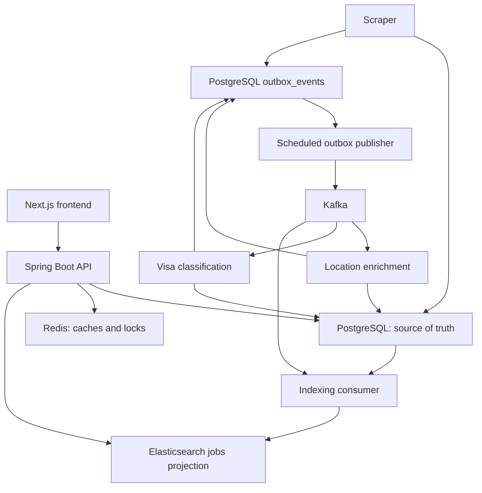

# Proxima Backend

Proxima brings company career listings into one searchable portal, with location enrichment, visa sponsorship signals, saved jobs, and application tracking. This repository contains the Spring Boot API and background processing pipeline.

Companion application: [Proxima Frontend](https://github.com/rohitmatcha-a11y/proxima-frontend-portfolio). These public portfolio copies are published separately from the private working repositories.

Clone the frontend into a sibling folder named `proxima-frontend` so local documentation links and Compose build paths resolve correctly:

```bash
git clone https://github.com/rohitmatcha-a11y/proxima-backend-portfolio.git proxima-backend
git clone https://github.com/rohitmatcha-a11y/proxima-frontend-portfolio.git proxima-frontend
cd proxima-backend
```

## Features

- Job search, filters, details, similar roles, and company profiles.
- Admin company registration with Greenhouse, Lever, Ashby, and a structured-data fallback for sites publishing JobPosting entries.
- Scheduled/manual scrapers, run history, cancellation, retry scheduling, and circuit-breaker controls.
- Kafka consumers for geocoding, AI-assisted visa classification, and search indexing.
- Google/GitHub sign-in, HttpOnly session cookies, and backend admin role checks.
- Saved jobs, application tracking, feedback, health endpoints, and Prometheus metrics.

## Stack

Java 21, Spring Boot 3.3.4, Spring Security, PostgreSQL 16, JPA, Liquibase, Kafka, Redis/Redisson, and Elasticsearch 8.13.0. Docker Compose provides infrastructure; production configuration includes Caddy, monitoring, and backup scripts.

## Architecture



Scrapers persist jobs and request baseline indexing and asynchronous enrichment through outbox rows. Enrichment updates PostgreSQL and requests another index update through the outbox. Elasticsearch holds a rebuildable projection. Keyword searches use Elasticsearch with a database fallback; browsing without a keyword uses PostgreSQL. Redis caches responses and supports distributed locks.

Read [Architecture And Limits](docs/ARCHITECTURE.md) for implementation references and delivery gaps. This is an Outbox-based pipeline, not an exactly-once delivery guarantee.

## Local Setup

Requirements: Java 21, Maven, Docker with Compose, and free ports 5432, 6379, 9092, and 9200. ZooKeeper uses 2181 and optional Kibana uses 5601.

```bash
cp .env.example .env
cp src/main/resources/application-dev.example.yml src/main/resources/application-dev.yml
openssl rand -base64 48
```

Edit `.env`: choose `POSTGRES_PASSWORD` and put a newly generated secret in `JWT_SECRET`. Configure Google or GitHub OAuth for sign-in using [AUTH_SETUP.md](AUTH_SETUP.md). Google needs the matching public client ID in the frontend. For the first admin account, set `SEED_ADMIN_ENABLED=true` and `ADMIN_EMAIL` to your verified Google email, sign in, then disable bootstrap again.

`ANTHROPIC_API_KEY` is optional for startup but required for AI visa classification. Without a key, the service cannot provide an AI assessment. Scraping and external enrichment also require network access.

```bash
docker compose up -d
mvn spring-boot:run
```

Wait for infrastructure health checks before starting Spring Boot. Liquibase creates the schema; no production export is needed. The default dev profile uses the ignored `application-dev.yml`, and the backend imports `.env`. Company seeding and scheduled scrapers are enabled by default; seeding may make external requests.

The API runs at `http://localhost:8080/api/v1`. Check `http://localhost:8080/api/v1/health`, then start the frontend at `http://localhost:3000`. Job browsing requires authentication; company registration and scraper controls require an admin account.

## Verification

```bash
mvn test
```

Tests cover JWT behavior, health responses, request logging, cache keys, company enrichment helpers, provider detection, and error redaction. They do not establish end-to-end Kafka/Elasticsearch delivery guarantees.

Optional Docker integration checks:

```bash
bash scripts/verify-fresh-production-db.sh
bash scripts/verify-full-production-stack.sh
```

Inspect the scripts before running. They create isolated Docker resources with dummy credentials; the full-stack script also builds the sibling frontend.

## Deployment And Demo

Read [OPERATIONS.md](OPERATIONS.md) for production configuration, TLS, monitoring, backups, and recovery. Set `FRONTEND_BUILD_CONTEXT=../proxima-frontend` when running production Compose with the folder layout above. Existing `jobz`/`jobportal` deployment identifiers and Java package names are retained for compatibility.

See [Demo Guide](docs/DEMO.md) for screenshots and a walkthrough. No live demo, user count, or performance benchmark is claimed in this source release. Company names, logos, and descriptions are third-party content; their appearance does not imply endorsement or ownership by this project.
